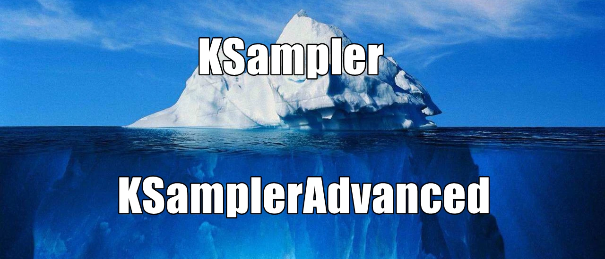
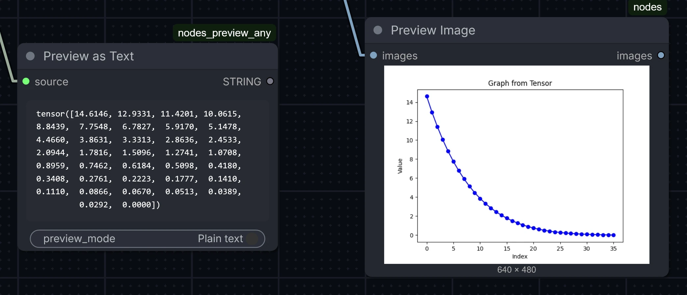
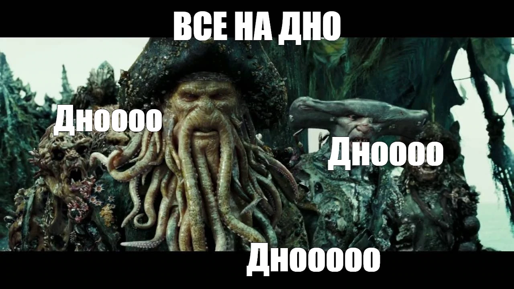

# ComfyUI: Regional Prompting (конец 2026)

Workflow из стрима:
- [`ComfyUI-03a-PhasedSampler.json`](ComfyUI-03a-PhasedSampler.json)
- [`ComfyUI-03b-Regional-Hooks.json`](ComfyUI-03b-Regional-Hooks.json)
  - и "причёсанный" исходный пример из [оф. блога Comfy](https://blog.comfy.org/p/masking-and-scheduling-lora-and-model-weights): [`ComfyUI-03d-Regional-HooksExample.json`](ComfyUI-03d-Regional-HooksExample.json)
- [`ComfyUI-03c-Regional-AttentionCouple.json`](ComfyUI-03c-Regional-AttentionCouple.json)

> [!NOTE]
> ## Проблема
> Ровно та же самая, что и в [случае с detailer'ами](ComfyUI-02-Detailer.md): качество генерации и конкретика того, что хотим получить - борются за дефицитное место в "пространстве смыслов" внутри conditioning'а. Что ведёт к двум источникам боли:
> - "Протекание" смыслов из одной сущности в другую.
> - Чем конкретнее прописываем, что хотим - тем хуже получается весь результат в целом.
> - А если спользуем много лор - так качество падает ещё сильнее (зачастую экспоненциально).

## 🌊 Погружаемся под покров 🌊: дробление денойза на этапы

Поскольку сам процесс денойза дискретен (он всегда происходит в n-ное поличество **отдельных** шагов), мы можем:
- разбить весь денойз на этапы, и на каждом - брать лучшее из двух миров:
- сперва - общая композиция с использованием лор (чтобы получить очертания именно тех объектов, к которым стремимся)
- потом - финальная полировка с максимально "голой" моделью (без лор) и коротким промптом.

Делается это - через ноду `KSampler (Advanced)`. Вместо коэффициента `denoise` она выдаёт два других параметра, которые вместе позволяют отденойзить только "кусок" всего процесса: `start_at_step` и `end_at_step`.

> [!TIP]
> Cтандартный `KSampler` - это просто обёртка над `KSamplerAdvanced`, и его `denoise` всего-навсего указывает, как далеко **ОТ КОНЦА** надо начать денойз, и во сколько шагов мы должны завершить его. То есть, следующие параметры идентичны по тому, что реально произойдёт под капотом:
> 
> | `KSampler` | `KSamplerAdvanced` | Суть |
> |---|---|---|
> | `steps=20` `denoise=1.0` | `steps=20` `start_at_step=0` `end_at_step=10_000` (любое дохуя большое значение) | Всего шагов - 20, начинаем - с самого начала, со 100% шума (`start_at_step=0`), останавливаемся - только в самом конце (на последнем шаге) |
> | `steps=20` `denoise=0.5` | `steps=40` `start_at_step=20` `end_at_step=10_000` | **СЕЙЧАС** денойзим - 20 шагов. Но мы делаем это, как будто половина денойза уже сделана, т.е. начинаем - с середины. Потому делаем как если бы весь денойз был в 40 шагов, из которого лишь последние 20 - наши. |
> | `steps=20` `denoise=0.1` | `steps=200` `start_at_step=180` `end_at_step=10_000` | Аналогично, но наши 20 последних шагов - это лишь 10% всего денойза. Так что работаем как будто всего было 200, из которых мы делаем только последние 20. |

Прелесть `KSamplerAdvanced` - в том, что он позволяет делать не **последние** несколько шагов, а отдельно вычленить **любую** часть всей последовательности. Таким образом, мы можем в несколько нод `KSamplerAdvanced`:
- Сперва - сгенерить черновик композиции с одним промптом и лорами;
- затем - **ДО**-генерить (в рамках **того же самого**, ещё не завершённого, денойза) наиболее важные нам объекты - с более детальными промптами;
- и наконец, когда картинка уже в целом оформилась - финально отполировать с максимально чистым и "общим" промптом, давая модели возможность сделать так, "как ей виднее" (и как она умеет).

Увы, при таком подходе - почему-то задирается контрастность и насыщенность (я так и не понял, почему: то ли из-за того, что разные лоры на разных этапах, то ли из-за самого факта денойза в несколько отдельных этапов). Но это легко чинится простым цветокором в конце первой генерации (до detailer'ов). Поэтому тут надо стремиться к "необходимости, но достаточности": дробим, но чем меньше этапов - тем лучше (обычно - хватает ровно трёх).

### А где ж тут региональность промптов?
А она - в том, что на центральном этапе мы можем не всю картинку денойзить, а делать лишь частичный inpainting нужных нам объектов - лишь с **их** лорами и промптами и лишь в их области по маске.

И поскольку это произойдёт, по сути, **внутри** первоначальной генерации (а не после) - картинка получится гораздо более согласованная, чем с настоящими inpainting'ами/detailer'ами, которые мы бы сделали после.

### Проблема нелинейности... и что ещё это за параметр - `sigmas`?

Да, придётся познакомиться аж со страшным словом "сигмы" (σ) и в целом понять кривую семплинга. Но оно того стоит. За подробностями - в стрим. Но тут...

> [!TIP]
> #### TL;DR
> - Создаёшь сигмы через `BasicScheduler`
> - Через `ExtendIntermediateSigmas` - добавляешь шагов в начале.
> - Через `SplitSigmas` - дробишь всю последовательность сигм на этапы денойза (как мы делали с `KSamplerAdvanced`).
> - Вместо `KSampler` используешь `SamplerCustom`
> - Ему на вход `sampler` втыкаешь не просто выбранный дропдаун с названием семплера (`dpmpp_2m`), а придётся из этого **названия** семплера сперва получить реально саму **сущность** семплера через служебную ноду `KSamplerSelect`.

После первых колупаний с `KSamplerAdvanced` вскоре станет понятно, что денойз происходит неоднородно: в начале - огромные объёмы шума удаляются большими "грубыми мазками", а в конце - происходит ювелирная полировка отдельных пикселей, во много-много шагов (при `karras` **ОДИН** первый шаг удаляет примерно столько же шума, сколько **ВСЯ ВТОРАЯ ПОЛОВИНА** денойза).
Нам же - хотелось бы самый первый этап "черновика" тоже сделать в несколько шагов, но при этом убрать лишь совсем немного шума (подготовить совсем приблизительную "болванку", дающую больше свободы лорам, но всё-таки **композиционно** - направляющую их туда, куда нам надо). Ради этого придётся спуститься ещё глубже - и перейти от "пользовательского" `KSampler` к совсем уж "прогерскому" `SamplerCustom`.

- 🙁 Плохая новость: таки придётся вникнуть в матчасть.
- 🙂 Хорошая новость: единожды это сделав, ты, скорее всего, уже не захочешь возвращаться к "упрощённому" `KSampler`, и просто всегда продолжишь пользоваться `SamplerCustom` по шаблону.

Для него - мы не просто выбираем алгоритм планировщика (scheduler), а прямо "в лоб" подаём ему конкретную последовательность значений того, **сколько именно** шума надо убрать на каждом шаге. А благодаря этому - можем:
- Сгенерировать такую кривую изначально - по стандартному алгоритму (`karras`);
- но потом - **вручную** добавить больше шагов на том конкретном этапе денойза (как правило, в начале), где нам этих шагов не хватает.

Это даёт два преимущества в сравнении с тупым задиранием шагов (для всей последовательности разом, как это делается для `KSampler`):
- Нам доп. шаги нужны - только в начале, а не на всём протяжении денойза. Так что мы не тратим драгоценное время генерации впустую на то, где от этого задирания не будет никакого выхлопа.
- Многие модели начинают сходить с ума, если попытаться сделать им денойз со слишком уж крохотными шажками. Они просто не были натренированны на таких данных - и не понимают, что тут от них хотят.

## ⏬ Опускаемся в самые дебри ⏬ - чтобы чередовать региональность **ПОШАГОВО**

Цепочка нескольких `KSamplerAdvanced` позволяет сперва отработать в одной зоне, потом - в другой. Но так - всё равно сохраняется их приоритет. Кто последний - "того и тапки": он единолично затирает пересекающиеся зоны тем, как хочется ему (лора Веги перегенерит руку Кейдана, которую захватывает в рукопожатии).
В идеале - было бы круто, если бы разные регионы работали **параллельно**, а не друг за другом.

Настоящей параллельности в ComfyUI из коробки - не добиться. Но мы можем хотя бы чередовать денойз регионов пошагово. Тогда - хоть разные регионы и не перемешаются для процесса денойза как равномерная каша - но они перемешаются, как две разных колоды карт (т.н. "конкурентная параллельность").

Теоретически - можно было бы это собрать на тех же `KSamplerAdvanced`, но:
- пришлось бы руками наплодить столько нод, сколько у нас шагов, а потом мучиться с правильным подсоединением нужных conditioning'ов и моделей в каждую;
- искажение цвета из-за целой вереницы нод `KSamplerAdvanced` улетело бы просто в кислотный ад.

### Решение: CLIP/CONDITIONING hooks
> [!CAUTION]
> Несмотря на то, что фича появилась аж в 2024, до сих пор (ноябрь 2026) все ноды отмечены как экспериментальные/beta. И оно чувствуется.
> - Сломать сетап, неаккуратно сделав "что-то не то" через хуки - легче лёгкого...
> - ... но и настройка (а вместе с ней - и результат) - именно с этим "сырым" методом регионального промптинга получается самой гибкой.

Анонс хуков в блоге Comfy: https://blog.comfy.org/p/masking-and-scheduling-lora-and-model-weights

Суть:
- В нынешних версиях Comfy - **прямо внутрь** сущностей CLIP и conditioning можно добавить команду: "когда будешь меня семплировать - сперва примени лору". Эта инструкция - и есть хук.
- Это никак не отображается на самих коннекшенах: они выглядят как самые обычные, даже если внутри себя содержат хуки.
- Потом, используя самый обычный `KSampler` (или его `Advanced` вариант, или вообще `SamplerCustom`) с таким "хукнутым" conditioning'ом, мы заставим модель сделать ровно то, что нам нужно: на каждом шаге поочерёдно семптировать разные зоны не только с разными промптами, но и даже с разными наборами лор. Тот же inpainting - но с детализацией чередования вплоть до шага.
- Очевидно, что чем больше зон мы добавим - тем дольше займёт генерация.

Главные достоинства:
- Максимально дроблёное чередование...
- ... при использовании разных лор...
- ... и даже вообще разных основных моделей внутри разных регионов.
- Предельно жёсткое следование маскам (с поправкой на разрешение latent space).
  - Градиент на масках - это смешивание не **финального результата**, а бесшовное перетекание **самих смыслов** (одной сущности в другую).
  - Его отсутствие - это жёсткая граница между ними.

Минусы:
- Оно ОЧЕНЬ хрупкое в настройке и требует весьма основательного понимания того, **что именно** ты делаешь и зачем.
- Самый прожорливый по ресурсам вариант. Как в плане времени генерации, так и в плане видеопамяти. На видеокартах менее, чем с 12 GB будет очень тяжко это использовать. А если хочется регионально применять именно что разные модели, а не просто лоры - придётся смириться, что это удовольствие - только для обладателей топовых видюх. Обе модели должны быть загружены, и если не влазят туда вместе - то либо скорость генерации превратися в совсем черепашью, либо - Comfy вообще может упасть, уронив вместе с собой и видеодрайвер (особенно на виндах).
  - Ровно поэтому для моделей нового поколения, которые и так еле-еле влазят в видеопамять - эта техника не подходит ни в каком виде.

## ⚛️ Спускаемся на атомарный уровень ⚛️: `Attention Couple`

> [!NOTE]
> На конец 2026 считается SOTA (state-of-the-art) техникой.

- Сперва мы генерили "всё вместе за раз" - в один проход,
- Потом мы подробили на этапы,
- Затем - в рамках центрального этапа научились денойзить разные куски кадра по отдельности,
- Следом - научились делать то же самое, но ещё и чередуя пошагово.

Настало время научиться в рамках **ОДНОГО** шага **ОДНОВРЕМЕННО** (воистину параллельно) применять разные промпты к разным частям изображения. Без inpainting'а вообще. Тут нам поможет `Attention Couple`.

Принцип:
- Вместо того, чтобы химичить с хуками, как-то по-хитрому организуя использование разных моделей на разных шагах...
- Мы прямо на лету, в видеопамяти, пропатчим **САМУ МОДЕЛЬ** таким образом, чтобы она **прямо внутри себя**, в качестве дополнительных весов, содержала уже закодированные conditioning'и - и при генерации разных областей изображения использовала их, а не тот основной conditioning, который мы воткнём в `KSampler`.

Плюсы:
- Не раздувает ни память, ни время генерации.
- Любое количество зон собирается вместе одной-единственной нодой.
- При умном™ промптинге - даёт максимально бесшовное перетекание смыслов, не плодя при этом бред в зоне их перехода.
- Позволяет модели по своему усмотрению "уточнять" маски зон - в том числе, совсем выходя за их рамки ради более правильной генерации (соблюдение анатомии, пропорций, перспективы, и т.д.).

Минусы:
- Одна модель на весь кадр.
- Один набор лор на весь кадр.
- Выбранные нами зоны - очень приблизительные...
- ... и не получится ими обозначить мелкие детали.
- Работает только через custom-ноды.

Есть несколько реализаций `Attention Couple`. Наиболее принятая/рекомендуемая в сообществе ComfyUI - из нод-пака [`ComfyUI-ppm`](https://github.com/pamparamm/ComfyUI-ppm).
